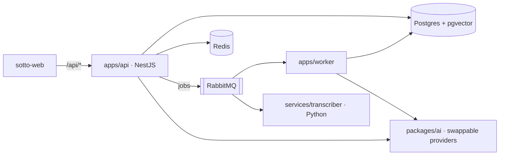

# sotto-api

Backend monorepo for **Sotto**: NestJS api, Node worker, Python transcriber and the Prisma database package.

> Where the build is, the plan and decisions: [sotto-platform](https://github.com/Harkanni/sotto-platform) → `docs/STATUS.md`.



## Run it locally (about 5 minutes)

Needs Node 24, pnpm 10 (`corepack enable` or `npm i -g pnpm@10`), Docker, and [uv](https://docs.astral.sh/uv/) for the transcriber.

```bash
cp .env.example .env
pnpm install
pnpm deps:up            # Postgres, Redis, RabbitMQ, S3 (SeaweedFS), Mailpit
pnpm build              # also generates the Prisma client
pnpm db:migrate
pnpm dev                # api on :4000, worker health on :4100
```

- API status: <http://localhost:4000/api/v1/status> · Swagger: <http://localhost:4000/api/v1/docs>
- Probes: `/healthz` (process up) and `/readyz` (database, Redis and queue reachable)
- RabbitMQ UI: <http://localhost:15672> (sotto / sotto) · Mailpit: <http://localhost:8025>

### Signing in locally

Run the web app too (`pnpm dev` in `../sotto-web`, which forwards `/api/*` here) and open
<http://localhost:3000>. Ask for a sign-in link; it lands in Mailpit (<http://localhost:8025>).
Sessions are cookies on the web's origin (`APP_URL`), so sign in through the web app, not port 4000. Google and Microsoft buttons appear once their credentials are in `.env`.

Transcriber:

```bash
cd services/transcriber
uv sync
uv run uvicorn app.main:app --reload --port 5000
```

The whole stack with the web app runs from `sotto-platform` (`task up`).

## Layout

| Path                   | What                                                                                     |
| ---------------------- | ---------------------------------------------------------------------------------------- |
| `apps/api`             | NestJS REST API under `/api/v1`, Better Auth under `/api/auth`; OpenAPI → `openapi.json` |
| `apps/worker`          | Queue consumer (processing arrives in Phase 4)                                           |
| `services/transcriber` | FastAPI; engine chosen by `TRANSCRIBER_ENGINE` (Phase 1: labelled mock only)             |
| `packages/db`          | Prisma 7 schema, migrations, client factory, tenant-scoped client                        |
| `packages/ai`          | Provider interfaces, registry, privacy rule (`canSend`), labelled mocks                  |
| `packages/contracts`   | Zod schemas for queue messages                                                           |
| `packages/config`      | Validated environment loading                                                            |

## Scripts

| Command                                       | Does                                                              |
| --------------------------------------------- | ----------------------------------------------------------------- |
| `pnpm build` / `pnpm typecheck` / `pnpm test` | Across every package (integration tests need `TEST_DATABASE_URL`) |
| `pnpm lint` / `pnpm format`                   | ESLint / Prettier                                                 |
| `pnpm openapi`                                | Regenerates `openapi.json` (CI fails if it's stale)               |
| `pnpm db:migrate`                             | Applies migrations                                                |
| `docker build --build-arg APP=api .`          | api image (`APP=worker` for the worker)                           |

## CI

GitHub Actions runs `.github/workflows/pipeline.yml` on every PR and every push to `main`: a secret scan (the files and every commit), lint, format, typecheck, unit + route tests, **integration tests against a real Postgres** (a fresh database per test file, built from the migrations), the Python checks, and a **smoke test** that builds the real arm64 images and boots them against real Postgres, Redis and RabbitMQ. An **ingestion** run takes a 3-page PDF and a 30-minute recording through those images (plus S3 and faster-whisper, tiny) to Ready and checks pages and timestamps (`scripts/ingestion-check.ts`; locally `API_URL=… MAILPIT_URL=… MEETING_FILE=… node scripts/ingestion-check.ts`), and the **eval set** runs with a real embedding model. On `main`, once every check passes, the same images go to ECR and the demo deploys them (skipped while the demo is down; run the workflow on `main` after `terraform apply`).

## Accounts and workspaces

- **Sign-in** is [Better Auth](https://better-auth.com) mounted at `/api/auth/*`: email magic
  links (any SMTP server), passkeys, Google and Microsoft. Its organization plugin is renamed
  Workspace, Membership and Invite; roles are owner, admin, member and viewer.
- **Every `/api/v1` route** passes one guard: a session, the session's active workspace and the
  caller's role in it, the CSRF token on writes (`X-CSRF-Token`, from `GET /api/v1/me`) and the
  route's minimum role. Nest's cross-origin protection refuses foreign writes before that.
- **Tenant data** goes through `forWorkspace(prisma, workspaceId)` from `@sotto/db`, which adds
  the workspace to every query and refuses writes into another one.
- **Errors** always look like `{ "error": { "code", "message", "requestId" } }`.
