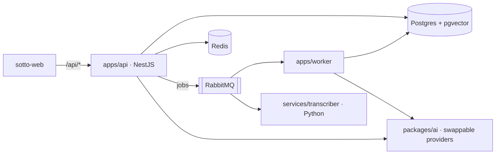

# sotto-api

Backend monorepo for **Sotto**: NestJS api, Node worker, Python transcriber and the Prisma database package.

> Where the build is, the plan and decisions: [sotto-platform](https://github.com/Harkanni/sotto-platform) → `docs/STATUS.md`.



## Run it locally (about 5 minutes)

Needs Node 24, pnpm 10 (`corepack enable` or `npm i -g pnpm@10`), Docker, and [uv](https://docs.astral.sh/uv/) for the transcriber.

```bash
cp .env.example .env
pnpm install
pnpm deps:up            # Postgres, Redis, RabbitMQ, S3 (SeaweedFS), Mailpit
pnpm build              # also generates the Prisma client
pnpm db:migrate
pnpm dev                # api on :4000, worker health on :4100
```

- API status: <http://localhost:4000/api/v1/status> · Swagger: <http://localhost:4000/api/v1/docs>
- Probes: `/healthz` (process up) and `/readyz` (database, Redis and queue reachable)
- RabbitMQ UI: <http://localhost:15672> (sotto / sotto) · Mailpit: <http://localhost:8025>

Transcriber:

```bash
cd services/transcriber
uv sync
uv run uvicorn app.main:app --reload --port 5000
```

The whole stack with the web app runs from `sotto-platform` (`task up`).

## Layout

| Path | What |
| --- | --- |
| `apps/api` | NestJS REST API under `/api/v1`; OpenAPI from decorators → `openapi.json` |
| `apps/worker` | Queue consumer (processing arrives in Phase 4) |
| `services/transcriber` | FastAPI; engine chosen by `TRANSCRIBER_ENGINE` (Phase 1: labelled mock only) |
| `packages/db` | Prisma 7 schema, migrations, client factory |
| `packages/ai` | Provider interfaces, registry, privacy rule (`canSend`), labelled mocks |
| `packages/contracts` | Zod schemas for queue messages |
| `packages/config` | Validated environment loading |

## Scripts

| Command | Does |
| --- | --- |
| `pnpm build` / `pnpm typecheck` / `pnpm test` | Across every package |
| `pnpm lint` / `pnpm format` | ESLint / Prettier |
| `pnpm openapi` | Regenerates `openapi.json` (CI fails if it's stale) |
| `pnpm db:migrate` | Applies migrations |
| `docker build --build-arg APP=api .` | api image (`APP=worker` for the worker) |

## CI

`ci.yml` runs on every PR: lint, format, typecheck, unit + route tests, the Python checks, a secret scan, and a **smoke test** that builds the real images and boots them against real Postgres, Redis and RabbitMQ. `images.yml` builds arm64 images on merge to `main`, pushes them to ECR and deploys the demo (once the platform Terraform is applied).
